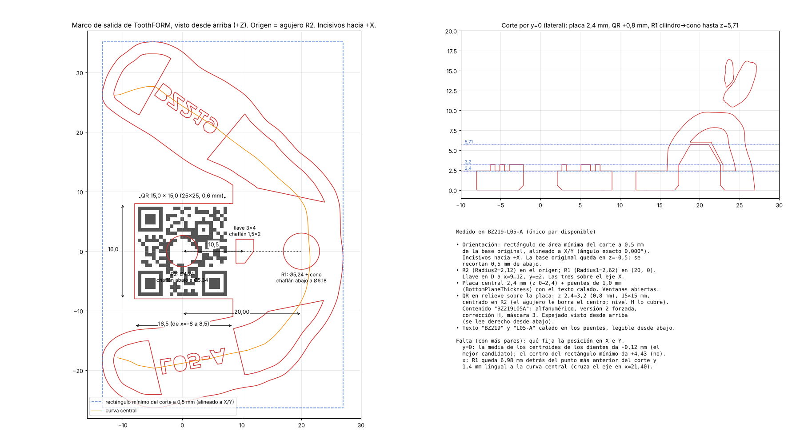

# ToothFORM: referencias del robot y QR (ingeniería inversa)

Medido sobre **dos pares** entrada/salida: BZ219-L05-A (inferior) y
BZ254-U05-A (superior), con ToothFORM release 20260518, Type1, y el
`config.json` del informe (`ShellThickness 1.8`, `BottomPlaneThickness 1.0`,
`QrSize 15.0`, `Radius1 2.62`, `Radius2 2.12`). Todo lo de la base, los
agujeros, el QR y el texto dio igual en los dos. Lo que no se pudo cerrar está
marcado como **a confirmar**.

Las salidas que importan: **la pieza con referencias** se imprime en 3D;
**`-gum.stl` y `-tooth.ply`** van al proceso que calcula la curva de corte.

Herramienta para medir: `tools/toothform_referencias.py` (ver al final).
Reproducción: `enkukador/toothform.py`, `--producto toothform` (ver
«Prototipo»).



## Marco de salida

La entrada aparece en la salida movida por un movimiento rígido: 48 740
triángulos quedan idénticos, y con ellos la transformación se recupera con
error ~1e-13 mm.

- **Giro solo en Z** (inclinación 0,00004°): ToothFORM confía en que la base
  ya viene plana. Para BZ219-L05-A: giro −103,887°, traslación (3,407; 0,029;
  15,310).
- **Recorta 0,5 mm de abajo**: la base original queda en z = −0,5 y el modelo
  se corta en z = 0.
- **Orientación y origen**: es el algoritmo de `Toothform.exe`, leído del
  binario en el plugin keep-form (workflow-bot-plugins, rama `draft`, 0.1.8) y
  traído acá. Con BZ219-L05-A y BZ254-U05-A el giro da 0,000° y el origen a
  0,001 y 0,005 mm del de ToothFORM:
  1. Plano de la base, Z hacia adentro; se cortan 0,5 mm.
  2. **Giro**: el lado más largo del casco convexo del contorno de corte (en
     la U, la recta que la cierra por atrás) queda paralelo a Y; incisivos
     hacia +X. (El rectángulo de área mínima que se había medido antes da lo
     mismo en estos dos casos, pero no es el criterio.)
  3. **Y = 0**: desde el centroide, siete rectas paralelas a Y a 2 mm sobre el
     corte, cada 2 mm en X; cada una da el punto medio entre las dos paredes
     más cercanas (si las dos están a 3 mm o más y el medio a menos de 20). El
     origen es el promedio: el medio de la arcada.
  4. **X**: el modelo se corre lo máximo entre dejar su frente (en y = 0) en
     x = 26 y su cara lingual (en y = ±(QrSize+1)/2) en x = 12,5
     (`IsAutoCutSupportedQr`, Core.dll). El 26 está medido en un solo par
     (BZ254-L22-A): **a confirmar**.
- **El superior también se da vuelta** y, si la base viene inclinada respecto
  de la Z del escáner (4,33° en BZ254), la apoya: usa el plano de la base.
- **Origen = centro del QR** = agujero R2.

## Referencias del robot

Las tres van sobre el eje X, en la placa central:

| | Posición | Forma |
|---|---|---|
| **R2** (`Radius2` = 2,12) | (0, 0) | Pasante, Ø 4,24. Chaflán abajo de ~0,55 mm a 45° (Ø 5,34 en z=0). Atraviesa el centro del QR. |
| **Llave en D** | x 9 → 12, y −2 → +2 | Pasante, rectángulo de 3 × 4 con la esquina (+x, −y) cortada de (10,5; −2) a (12; 0). Anti-giro. |
| **R1** (`Radius1` = 2,62) | (20, 0) | Ciego. Cilindro Ø 5,24 desde z = 0 hasta ~3,2, cono de 30° de semiángulo hasta un fondo plano en z = 5,71 (Ø ~2,3). Chaflán abajo de ~0,47 mm (Ø 6,18 en z=0). Queda bajo los incisivos, rodeado de material. |

Los radios del config son exactamente los de los agujeros (2,118 y 2,618
medidos).

## Placa, piso y texto

- **Placa central** de 2,4 mm (z 0 → 2,4): la lengüeta, de x = −8 a 8,5 e
  y ±8 (16,5 × 16), y un puente bajo los incisivos hasta la pared labial.
- **Dos puentes de 1,0 mm** (`BottomPlaneThickness`) cruzan la arcada, uno
  en cada rama, de ~14,4 mm de ancho a lo largo de la arcada. Llevan el texto
  **calado de lado a lado**.
- **El resto del fondo queda abierto**: cuatro ventanas (dos distales y dos
  laterales anteriores) por las que se ve la cavidad. La pared de 1,8 mm apoya
  en z = 0. **A confirmar** la regla exacta de los bordes de las ventanas
  (son rectas que cruzan la arcada).

### Texto

- **Qué dice**: el caso en la rama +Y («BZ219», «BZ254») y el modelo en la
  rama −Y («L05-A», «U05-A»), legibles desde abajo (vistos desde arriba están
  espejados).
- **Fuente: Verdana Bold**, cuerpo 3,44 mm (mayúsculas de 2,5 mm de alto). Es
  el `font.ttf` que viene en la carpeta de ToothFORM (confirmado).
  Comparada contra todas las fuentes a mano: Verdana Bold coincide con
  IoU 0,83 y los centros de cada letra a ±0,12 mm; DejaVu Sans Bold (que viene
  con matplotlib) queda segunda con 0,79.
- **Sin contadores**: la B, el 0, el 9 y la A van rellenos. Como el texto
  atraviesa el puente, el centro de esas letras quedaría suelto.
- **Dónde**: centrado sobre la curva central de la arcada (a 0,04–0,2 mm),
  siguiendo su tangente (±2–5°), al **70 % del largo de su rama** contando
  desde el frente (0,70; 0,71; 0,70; 0,73). Con eso las letras caen con
  IoU 0,79–0,84 si se alinean los centros; el corrimiento a lo largo de la
  curva es de 0,5 a 2 mm (**a confirmar** la regla exacta).

## QR

- **En relieve sobre la placa**: de z 2,4 a 3,2 (0,8 mm). Es un cuadrado de
  15,0 × 15,0 mm (`QrSize`) **centrado en R2**, sin zona de silencio propia:
  la hace la placa de alrededor, que llega a −8.
- **25 × 25 módulos de 0,6 mm.** Es la versión 2, forzada: en versión 1 el
  texto entraba con corrección H.
- **Contenido: `BZ219L05A`**, el nombre del archivo sin guiones.
  Alfanumérico, corrección **H**, **máscara 3**. Coincide módulo a módulo con
  el que genera `segno` con esos parámetros: 0 diferencias fuera del agujero.
- **El agujero R2 le borra 37 módulos del centro**. La corrección H (30%) lo
  absorbe y se lee igual.
- **Orientación**: visto desde arriba está espejado (girado 180° y espejado);
  **se lee derecho desde abajo**. Ver `toothform/qr_BZ219L05A_estandar.png`
  para el código sin agujero.

Para generarlo igual:

```python
segno.make_qr(f"{caso}{modelo}".replace("-", ""), error="h", version=2,
              mode="alphanumeric", mask=3, boost_error=False)
```

En BZ254-U05-A también fue máscara 3 (`BZ254U05A`, 0 diferencias), así que
todo indica que está fija.

**Aristas no-manifold**: las 43 que tiene la salida de ToothFORM están todas en
el QR, donde dos módulos se tocan solo por una esquina. El prototipo agranda
cada módulo 5 µm para que se solapen y la pieza sale cerrada y sin
no-manifold.

## Encía y dientes (`-gum.stl`, `-tooth.ply`)

- **`-gum.stl`**: la encía de la entrada, en el marco de salida, **sin lo que
  queda dentro de algún diente**, cortada en z = 0 y **tapada ahí**. Queda
  abierta solo donde apoyan los dientes. En BZ219-L05-A: de las caras de la
  encía que faltan, 8 266 estaban dentro de un diente y 1 950 debajo del
  corte; la tapa son 1 137 mm². El prototipo da la misma área (2 897,3 mm²) y
  las dos superficies están a 0,002 mm como mucho; solo cambia la
  triangulación.
- **`-tooth.ply`**: PLY ASCII. No hubo muestra para comparar. Según el informe
  (33 344 vértices y 66 636 caras en otro modelo): 2·V − F = 52 = 4 × 13, o
  sea 13 piezas cerradas. El prototipo escribe los dientes tal cual, cerrados,
  en el marco de salida. **A confirmar** con una muestra (encabezado,
  precisión y si están recortados).

## Prototipo

`python -m enkukador CARPETA --producto toothform --salida SALIDA [--config config.json]`
deja `SALIDA/<ID>/<modelo>.stl`, `-gum.stl` y `-tooth.ply`, y un
`<fecha>.<hora>.log` con el mismo formato que ToothFORM. Lee
`ParameterSettings` del mismo `config.json`.

- **Pieza**: unión de todas las piezas, corte en z = 0, hueco cosido
  (`hueco.py`), placa, puentes, macizo alrededor de R1, QR en relieve, y se
  restan R2, R1 con su cono, chaflanes, llave y texto. Una sola malla cerrada.
- **Límites**: `LimitH` (alto) y `LimitR` (diámetro, según el documento de
  errores del fabricante; medido alrededor del QR) cortan con
  `Height limit exceeded` y `Radius limit exceeded`, sin exportar la pieza.
- **Clip (`LimitX`)**: es el pasillo de la pinza hacia el QR (Toothform.exe,
  leído en keep-form): con w = (QrSize+1)/2, ningún vértice con x ≤ 10 − w
  puede quedar a |y| < w + LimitX. Separa BZ254-U00-B y U01-A (2,45 y 2,44,
  rechazados) de U05/U06 (2,51–2,55, aceptados). **Solo avisa** todavía:
  BZ472-U00-B, rechazado, da 3,49 y eso no lo explica.
- **Estados del log** con los nombres de ToothFORM: `Export successfully`,
  `Fail to hollow, changed to solid` (no se pudo vaciar: sale maciza y cuenta
  como exportado), `Failed to preprocess`, `Failed to hollow`,
  `Failed to merge`, `Height/Radius limit exceeded`.
- **Robustez** (de keep-form): la unión no junta vértices (piezas que se
  tocan por una arista: BX087, BX059); si la costura no cierra, se resta la
  cavidad con manifold3d (BY184-U03-A); y la pieza queda en un solo cuerpo
  (las booleanas dejaban pedacitos en 9 de 44 modelos de BZ219).
- **Muesca del pasillo** (keep-form 0.2.0, apagada por defecto:
  `AbrirPasillo`): si el pasillo no llega a `LimitX`, se le saca a la encía
  (no a los dientes, antes de vaciar) una cuña desde la cara del QR (z=3,2),
  inclinada 2° hacia arriba, hasta `LimitX` + `PasilloMargen`. Es «Clip limit
  exceeded» si hay un diente en el pasillo o a menos de `PasilloDiente`, si
  falta más que `PasilloTolerancia` o si la cuña no sale de la pared antes de
  `PasilloAltoMax`. `-gum.stl` sale con la muesca.
- **`-MatA.txt`**: dos identidades 4×4, CRLF, como los 1492 de 2026.
- **Type3** (keep-form 0.3.0, leído del binario, **a confirmar con un caso
  real**): un STL de un solo shell (encía y dientes fundidos) y
  `<modelo>.pts` al lado; sin el `.pts`, «Pts file not found!». Al cargar se
  descartan las piezas de menos de 100 caras; la pieza y `-gum.stl` salen del
  shell entero; no hay `-tooth.ply`. El `.pts` (un punto por línea, x y z por
  espacios o tabulaciones; lo demás se ignora) sale como `-pts.pts` en el
  marco de la pieza, 6 cifras significativas y CRLF. CLI: `--tipo-dato
  Type3`; interfaz: «Tipo de dato» con ToothFORM elegido.
- `--paralelo N` procesa N modelos a la vez (en una PC con pocos núcleos
  puede tardar más).
- **Medido contra ToothFORM** con la misma herramienta (`toothform_referencias.py`):
  mismos niveles (0; 1,0; 2,4; 3,2; 5,71; 6,01), agujeros Ø 4,24 y 5,24 en
  (0, 0) y (20, 0), QR con 0 módulos distintos, mismo alto (18,41 y 18,17).
  Volumen 4 % y 2 % menor (el hueco y las ventanas no son idénticos). Giro
  igual a ToothFORM (0,000°) y origen a 0,001 y 0,005 mm del suyo.
- ~8–9 s por modelo.

## Lo que falta y qué datos sirven

1. **Confirmar el 26 de la regla del frente** (`QR_FRENTE_X`), la regla de
   las ventanas y la ubicación exacta del texto. Hacen falta más pares
   entrada/salida, con superiores e inferiores. Con eso se corre:

   ```bash
   python tools/toothform_referencias.py --pares ENTRADAS/ SALIDAS/ > medidas.jsonl
   ```

   Cada línea trae los candidatos (`candidatos`): el que dé siempre ~0 es el
   criterio.
2. **El plano del agarre del robot**, para confirmar tolerancias, el sentido
   de la llave y si R1 es un centrador cónico.
3. **Una muestra de `-tooth.ply`** de ToothFORM.
4. **El clip en BZ472-U00-B**, que el pasillo del QR no explica, y desde
   dónde mide ToothFORM el diámetro de `LimitR`.
5. **Type2**, y un par real de **Type3** para validarlo.
6. **Qué hace ToothFORM cuando el QR no entra** (`IsAutoCutSupportedQr`,
   `CreateMeshWithOutQR`).

## Herramienta

```bash
python tools/toothform_referencias.py SALIDA.stl --entrada ENTRADA.stl
```

Imprime niveles horizontales, agujeros (centro y diámetro a z = 1,5 y
z = 0,05), el QR (caja, módulos, matriz y contenido) y, con la entrada, la
matriz entrada → salida, el recorte de la base y los candidatos para el
origen.

Para decodificar el QR necesita `zxing-cpp` y para confirmar los parámetros,
`segno`; sin ellos imprime la matriz. No son dependencias del programa:
instalarlos aparte (`pip install zxing-cpp segno`). Tarda ~18 s por par, casi
todo en la registración.
